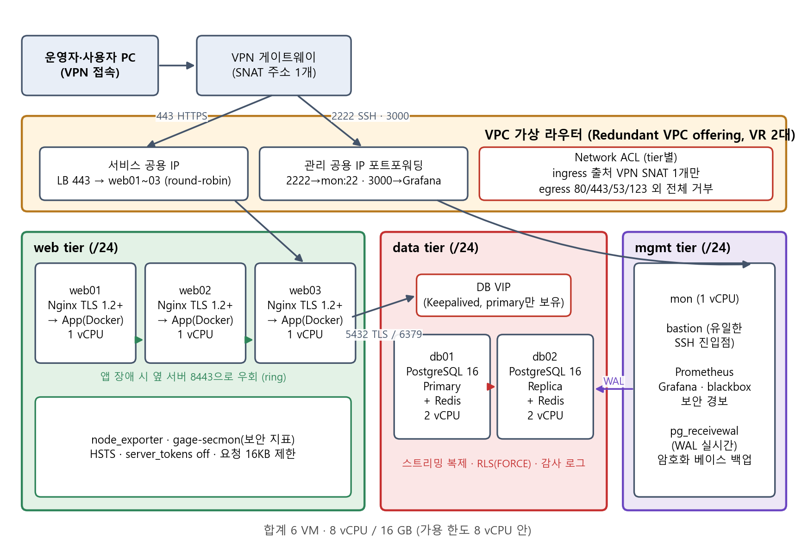
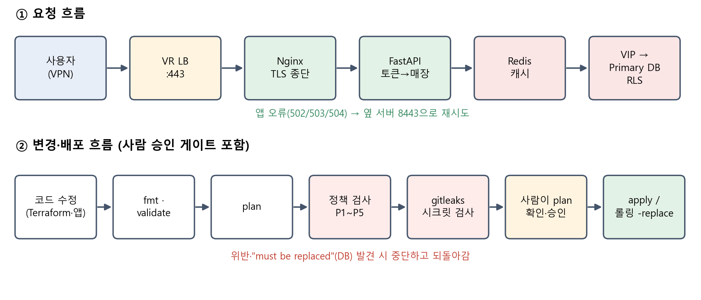
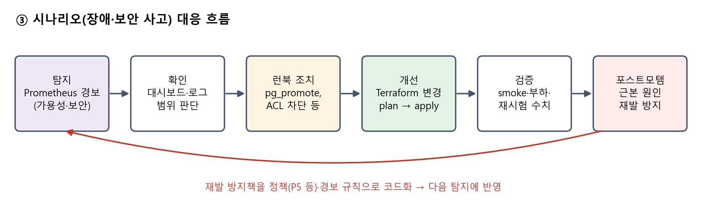
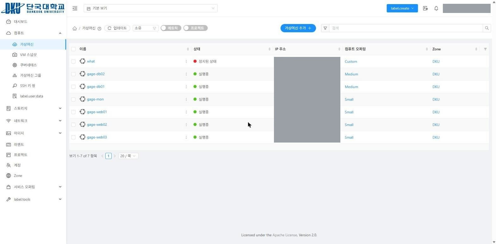
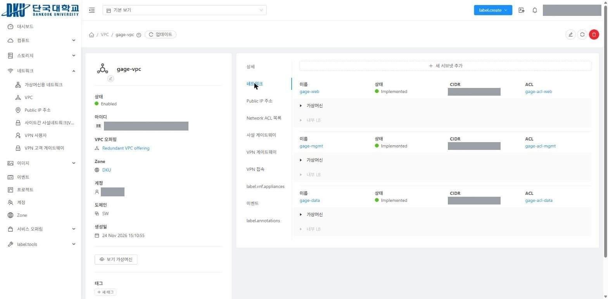
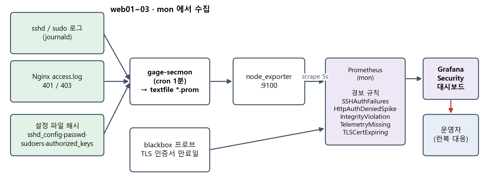
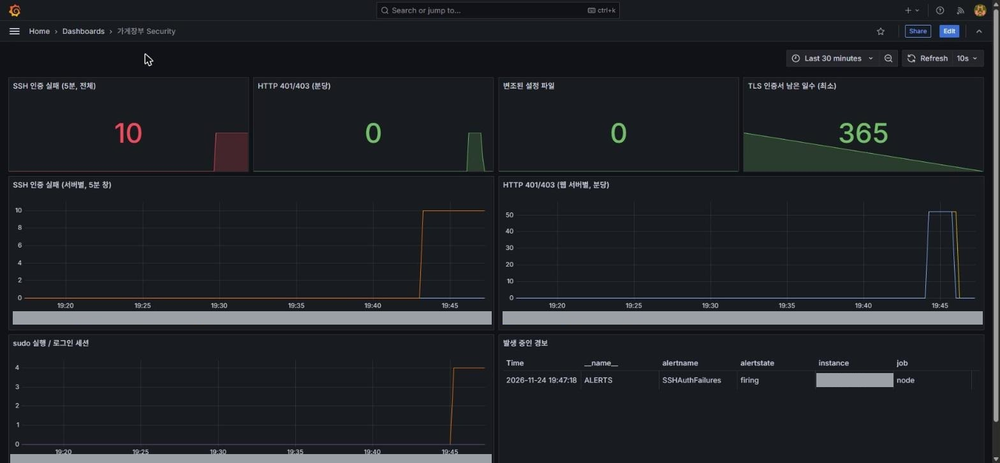
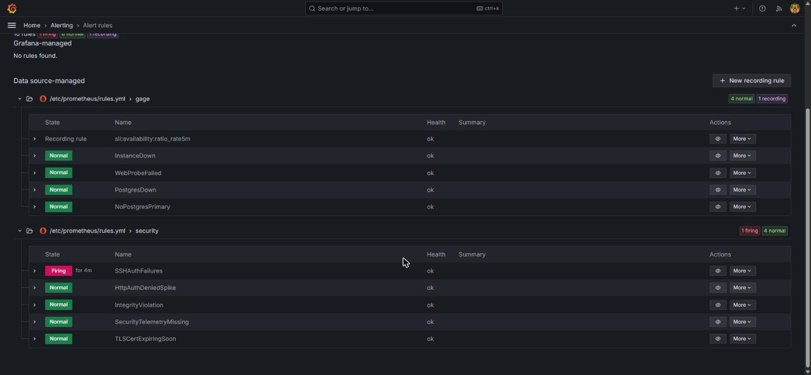

# 가게장부 — 소상공인 주문·재고 관리 인프라 설계 및 구축

> 수치는 모두 2026-11-24 Solid Cloud(DKU 존)에서 실측했다. 원본 출력은 `evidence/`에 있다. 추정치에는 "가정"이라고 표시했다.

## 1. 서비스 소개와 요구사항  (평가 ① 8점)

### 1.1 문제와 사용자
- **사용자**: 매장 여러 개를 운영하는 소상공인. 사장님은 자기 매장의 주문과 재고만 본다.
- **기능**: 상품·재고 조회, 주문 등록(재고 원자적 차감과 감사 로그), 주문 조회. 매장(테넌트)별 API 토큰으로 접근한다.

### 1.2 우선순위와 트레이드오프
| 순위 | 항목 | 이유 | 양보한 것 |
|---|---|---|---|
| 1 | 보안·규제 | 매출과 주문 데이터를 다룬다. 다른 매장에 데이터가 보이면 곧 사업 신뢰를 잃는다 | TLS·RLS·감사 로그로 지연이 늘어나는 것을 감수 |
| 2 | 가용성 | 영업 중 주문 입력이 멈추면 바로 매출 손실이다 | 이중화로 자원을 전부(8 vCPU) 사용 |
| - | 성능·확장 | 소상공인 규모는 트래픽이 작다 | 자동 확장 없이 Terraform 변수로 수동 확장 |
| - | 비용 | 교내 Solid Cloud를 쓴다 | 상용 단가는 8장에서 가정으로 계산 |

### 1.3 규모 가정
- 매장 200개 × 하루 주문 100건 = 하루 2만 건 (가정)
- 점심 피크는 평균의 약 10배, 주문 1건당 API 호출 약 5회 → **피크 약 50 RPS**

### 1.4 수치 목표와 결과
| 구분 | 목표 | 실측 | 근거 |
|---|---|---|---|
| 성능 | 50 RPS에서 p95 ≤ 300ms, 오류율 ≤ 1% | p95 124ms, 오류 0% (2대 기준) | `evidence/load-50rps.txt` |
| 여유 용량 | 목표 RPS의 3배 이상 | 400 RPS에서 p95 201ms, 오류 0% (3대) | `evidence/load-400rps-web3.txt` |
| 웹 장애 | 앱 1대 장애 시 오류 없음 | 성공률 50% → 100% (수정 후) | `evidence/failover-web.txt` |
| DB 장애 | RTO ≤ 30분, RPO ≤ 1분 | RTO 11.4초, RPO 0 | `evidence/failover-db.txt` |
| 백업 복구 | 암호화 백업에서 복구 가능 | 18초 만에 복구, 주문 18,755건 일치 | `evidence/restore-test.txt` |
| 무중단 배포 | 가용성 99% 이상 | 롤링 교체 중 99.47% | `evidence/rolling-probe.txt` |
| 테넌트 분리 | 다른 매장 데이터 조회 0건 | 7/7 통과 | `evidence/smoke-test.txt` |
| 보안 탐지 | SSH 대입·토큰 추측·설정 변조 경보 | 3종 모두 탐지, 28~93초 | `evidence/security-monitoring.txt` |
| 외부 개방 | 443, 2222, 3000만, 출처는 VPN 게이트웨이 1개 | 정책 P1·P4로 강제, 위반 0건 | `evidence/policy-check.txt` |

## 2. 아키텍처와 설계 근거  (평가 ② 20점)

### 2.1 전체 구성도

### 2.2 자원 배분 (가용 8 vCPU / 64 GiB 안에서)
| VM | 오퍼링 | 수량 | vCPU | 메모리 |
|---|---|---|---|---|
| web | Small (1 vCPU/2GB) | 3 | 3 | 6 GB |
| db | Medium (2 vCPU/4GB) | 2 | 4 | 8 GB |
| mon (bastion) | Small | 1 | 1 | 2 GB |
| **합계** | | 6 | **8** | **16 GB** |

처음에는 web 2대(7 vCPU)로 설계했다. 부하 시험에서 웹 CPU가 병목으로 확인돼(5.1절) 3대로 늘렸다. 남은 CPU는 0이다. 메모리는 여유가 있다.

### 2.3 설계 요소
| 요소 | 내용 | 근거 |
|---|---|---|
| 네트워크 분리 | VPC 3 tier + tier별 Network ACL. 데이터 tier는 web에서 5432/6379만 받는다 | 최소 권한 |
| egress 통제 | 80/443/DNS/NTP만 허용하고 나머지는 명시적으로 거부 | 침해 시 외부 유출과 C2 통신 차단 (S4) |
| 부하분산 | VR LB 규칙 443 → web 전체 | 포트포워딩은 VM 1대에 고정된다 |
| 앱 장애 우회 | 각 Nginx가 자기 앱이 실패(502/503/504)하면 옆 웹 서버 8443으로 넘긴다 | VR LB에는 헬스체크가 없다 (5.2절) |
| DB 이중화 | 스트리밍 복제 + Keepalived VIP. 상태 검사 `pg_is_primary`로 primary만 VIP를 갖는다 | 앱은 VIP 하나만 안다 |
| 승격 방식 | 운영자가 `pg_promote()` 1회 실행 (자동 승격 안 함) | 네트워크 분할 시 primary가 둘 생기는 split-brain을 막는다. RTO 목표 30분 안에 충분하다 |
| 테넌트 분리 | PostgreSQL RLS(FORCE). 앱은 테이블 소유자가 아닌 `gage_app`으로 접속한다 | 앱 버그가 있어도 DB가 차단한다 |
| 암호화 | 전송: Nginx TLS 1.2+, HSTS, 앱→DB `sslmode=require` / 저장: 백업 AES-256 | 규제 요건 |
| 시크릿 | Terraform `random_password`로 생성해 state(gitignore)에만 둔다. 저장소에는 없다 | 키 유출 10점 감점 규정 |
| 감사 | 주문마다 `audit_log`에 INSERT (앱 권한은 INSERT만) | 기록 변경 불가 |
| 관측 | Prometheus(node·postgres exporter, blackbox HTTPS 프로브), Grafana, 가용성 경보 4종 + 보안 경보 5종 (4.4절) | SLI 측정, 공격 탐지 |
| 백업 | `pg_receivewal --synchronous`로 WAL 실시간 수신 + 매일 암호화 베이스 백업 | RPO 0에 가깝게 |

### 2.4 SPOF 분석
| 구성요소 | SPOF 여부 | 대응 / 한계 |
|---|---|---|
| web | 아니오 | 3대 + LB + 서버 간 우회 |
| DB | 아니오 | Replica 승격(RTO 11.4초 실측) |
| Redis | 아니오 | 캐시 장애 시 DB로 폴백 (성능만 저하) |
| 가상 라우터 | 완화 | Redundant VPC offering(VR 2대) 사용 |
| mon | 서비스 경로 밖 | 장애 시 관측·관리 접근만 영향. WAL 백업이 끊긴다 |

### 2.5 대안 비교
| 결정 | 선택 | 대안 | 이유 |
|---|---|---|---|
| 워크로드 | VM + Docker | Kubernetes | 8 vCPU에서 K8s 컨트롤 플레인 오버헤드가 크다 |
| 설정 전달 | Terraform이 bastion을 거쳐 SSH로 cloud-config를 NoCloud seed에 넣는다 | VR user-data | 이 환경의 VR이 user-data를 주지 않았다 (7장) |
| 변경 반영 | VM 교체(불변 인프라, `-replace`) | 실행 중인 VM에서 cloud-init 재실행 | 상태 있는 DB에서 재실행하면 위험하다 |
| 테넌트 분리 | RLS (공유 DB) | 테넌트별 DB | 매장 200개에 DB 200개는 운영할 수 없다 |

### 2.6 워크플로우

- **요청**: 사용자 → VR LB:443 → web Nginx(TLS) → 앱 → (Redis 캐시) → VIP → Primary DB
- **배포**: 코드 수정 → `terraform fmt/validate` → `plan` → 정책 검사(P1~P5) → `apply` → 웹은 한 대씩 `-replace` (scripts/rolling.ps1)
- **장애**: Prometheus 경보 → 런북(6.2절) → 조치 → 회고

## 3. 구축과 재현성  (평가 ③ 12점)

| 파일 | 내용 |
|---|---|
| `terraform/network.tf` | VPC, tier, ACL(ingress/egress, 전체 거부), 공용 IP, LB, 포트포워딩 |
| `terraform/compute.tf` | 시크릿 생성, VM 6대, cloud-config 렌더링 |
| `terraform/provision.tf` | bastion 경유 SSH 프로비저닝 (mon은 마지막) |
| `terraform/templates/*.tftpl` | web/db/mon cloud-config |

- 모든 자원은 Terraform으로 만든다. 콘솔에서 수동으로 만든 자원은 없다. 이 Terraform이 만들지 않은 기존 자원(8 vCPU / 64 GiB)은 조회만 하고 건드리지 않았다.
- **재현성 시험**: `terraform destroy` → `apply` → 다시 `plan` (scripts/repro.ps1). 결과는 `evidence/repro.txt`:
  - destroy: 163초, 37개 삭제
  - apply: 261초, 37개 생성 (VM 6대, SSH 프로비저닝 포함)
  - 다시 plan: "No changes" (멱등)
  - 이후 서비스 기동 완료까지 약 10분. VM 6대 모두 cloud-init `done`, 스모크 7/7 통과, 경보 0건, `pg_up` 2/2 (`evidence/repro-health.txt`, `evidence/smoke-test.txt`)
  - 공용 IP는 이번에는 같은 주소를 다시 받았다. 주소가 바뀌어도 `terraform output service_url`로 확인할 수 있다.
- 매 변경마다 `fmt` → `validate` → `plan` → `check_plan.py` → `apply` 순서로 진행했다.

## 4. 보안·DevSecOps  (평가 ⑤ 10점)

### 4.1 접근 제어
- 외부 개방은 443(서비스), 2222(SSH→mon), 3000(Grafana) 세 개뿐이다. 출처는 VPN 게이트웨이 `<VPN SNAT>` 하나다.
- SSH는 키 인증만 허용한다(`ssh_pwauth: false`). 내부 VM은 mon을 거쳐서만 들어갈 수 있다.
- DB는 web tier에서 TLS(`hostssl`)로만, 복제는 data·mgmt tier에서만 받는다.

### 4.2 정적 분석과 Policy as Code
- Trivy·Checkov에는 CloudStack 리소스 규칙이 없어서(Trivy 0건, Checkov는 외부 정책 로드 실패) plan JSON을 검사하는 `policies/check_plan.py`를 직접 만들었다.

| 규칙 | 내용 |
|---|---|
| P1 | ingress 출처 0.0.0.0/0 금지 |
| P2 | 오퍼링은 Small/Medium만 (한도·비용 상한) |
| P3 | `expunge = true` (destroy 후 볼륨이 남지 않게) |
| P4 | 공개 포트는 443/2222/3000만 |
| P5 | 모든 ACL에 egress 전체 거부 규칙 필수 (S4 시험에서 추가) |

- 앱 코드도 `trivy fs --scanners vuln,secret,misconfig app`로 검사했다. 의존성 취약점 0, 시크릿 0, Dockerfile 설정 0건 (`evidence/trivy-app.txt`). Trivy가 잡지 못하는 CloudStack 규칙은 아래 정책(P1~P5)으로 보완했다. 실제로 P5가 egress 미차단을 잡았다(6.1절).
- `--selftest`로 위반 샘플을 넣어 다섯 규칙이 모두 잡히는지 확인했다. 수정 전 plan은 P5 위반 1건(`evidence/policy-check-s4-before.txt`), 현재 plan은 위반 0건이다.

- 파이프라인: `.github/workflows/check.yml`이 push마다 fmt·validate, Trivy, 정책 selftest, gitleaks(커밋 이력 전체)를 실행한다. apply는 VPN 안에서 사람이 plan을 확인한 뒤 실행한다.

### 4.3 시크릿 관리
- API 키는 `terraform.tfvars`(gitignore)에만 둔다. DB, Redis, Grafana, 백업, 테넌트 토큰은 Terraform이 생성한다.
- 커밋 전 `gitleaks git --pre-commit --staged --redact`로 검사한다. 현재 스테이징 영역은 "no leaks found"다.
- plan 파일과 `terraform show -json` 출력에 sensitive 값이 평문으로 들어가는 것을 확인했다. 그래서 `.gitignore`에 추가했다 (6.1절).

### 4.4 보안 모니터링 (Prometheus + Grafana)
가용성 지표만으로는 공격을 볼 수 없다. 그래서 같은 Prometheus·Grafana에 보안 지표를 더했다. 에이전트를 새로 깔지 않고, 이미 있는 node_exporter의 textfile collector를 썼다.

| 지표 (`gage-secmon`, 1분마다) | 수집 위치 | 경보 | 대응하는 위협 |
|---|---|---|---|
| SSH 인증 실패 (5분) | web, mon(bastion) | `SSHAuthFailures` > 5 | 무차별 대입 |
| HTTP 401/403 누적 | web Nginx | `HttpAuthDeniedSpike` 분당 60건 초과 | 토큰 추측, 다른 매장 접근 시도 |
| 설정 파일 해시 불일치 | web, mon | `IntegrityViolation` > 0 | sshd·sudoers·authorized_keys 변조(백도어) |
| 수집 파일 갱신 시각 | web, mon | `SecurityTelemetryMissing` 3분 | 공격자가 수집을 멈춰 경보를 끄는 경우 |
| TLS 인증서 만료일 | blackbox | `TLSCertExpiringSoon` 30일 | 인증서 만료로 인한 장애 |
| sudo 실행, 로그인 세션 | web, mon | 대시보드만 | 권한 상승 추적 |

- Grafana "가게장부 Security" 대시보드는 Terraform이 프로비저닝한다(`terraform/templates/security-dashboard.json`). 콘솔에서 손으로 만들지 않는다.
- DB VM은 이번에 교체하지 않아 지표가 없다. DB는 mon(bastion)을 거쳐서만 SSH가 되므로, bastion의 SSH 실패 지표가 사실상 입구를 감시한다. 다음 DB 교체 때 같은 스크립트를 넣는다.

**시험** (`scripts/sec_test.py`, 결과 `evidence/security-monitoring.txt`). 시작 전 경보는 0건이었다.

| 공격 흉내 | 결과 | 경보 | 탐지까지 |
|---|---|---|---|
| bastion에 없는 사용자로 SSH 10회 | 모두 거부 | `SSHAuthFailures` | 66.3초 |
| 잘못된 토큰으로 API 300회 | 300건 모두 401 | `HttpAuthDeniedSpike` | 93.4초 |
| mon의 sshd_config에 한 줄 추가 | - | `IntegrityViolation` | 27.7초 |

- 원복하자 불일치가 0으로 돌아왔다. 탐지 시간은 수집 주기(1분)와 경보 대기(`for`)를 더한 값이다. 더 빨라야 하면 수집 주기를 줄이면 된다.
- 한계: 로그 기반이라 공격자가 root를 얻으면 로그와 스크립트를 지울 수 있다. 수집이 멈추면 `SecurityTelemetryMissing`이 울리게 해서 "조용해진 것"도 잡는다. 로그를 외부로 보내 보관하는 것은 다음 과제다.

## 5. 검증과 수치  (평가 ④ 15점)

### 5.1 부하 시험과 병목
`scripts/load.py`: open model, 조회 80% / 주문 20%, 두 매장 토큰을 섞어 보낸다.

| 조건 | 실제 RPS | p50 | p95 | p99 | 오류율 |
|---|---|---|---|---|---|
| web 2대, 50 RPS (목표) | 49.7 | 73ms | 124ms | 354ms | 0% |
| web 2대, 150 RPS | 149.9 | 62ms | 88ms | 112ms | 0% |
| web 2대, 400 RPS | 390.3 | 122ms | **1167ms** | 1363ms | 0% |
| **web 3대, 400 RPS** | 399.6 | 59ms | **201ms** | 303ms | 0% |

- **병목 찾기**: 400 RPS 부하 중 `vmstat`을 보니 web01은 CPU user 78% + sys 20~22%로 유휴가 0~1%였다. db01은 유휴 78%였다. 그래서 병목은 웹 CPU다(Small 1 vCPU).
- **조치**: `web_count` 2 → 3 (Terraform 변수 하나). p95가 1167ms → 201ms로 5.8배 좋아졌다. 남은 CPU 한도가 0이라 더 늘릴 수는 없다.

### 5.2 웹 장애
- 시험: web01의 앱 컨테이너를 멈추고 60초 동안 0.5초마다 `/healthz`를 호출했다.
- **수정 전: 성공률 50.0% (502 55건)**. VR LB는 헬스체크 없이 죽은 서버에도 계속 보낸다.
- 조치: Nginx `error_page 502 503 504 = @peer` → 옆 서버의 8443(앱 직결, 다시 넘기지 않음)으로 우회.
- **수정 후: 성공률 100% (107/107)**.
- 한계: VM 자체가 죽으면 LB가 여전히 그 VM으로 보낸다. 롤링 교체 중 실패 7건이 이 경우다(5.5절).

### 5.3 DB 장애 (RTO/RPO)
`scripts/failover_db.py`: 1초마다 주문을 넣는다. 10초 시점에 db01 PostgreSQL을 SIGKILL하고, 3회 연속 실패하면 db02에서 `pg_promote()`를 실행한다.

| 항목 | 값 |
|---|---|
| 장애 주입 | 12.1s |
| 승격 실행 (감지 후) | 18.2s |
| 첫 주문 성공 | 23.5s |
| **RTO** | **11.4초** |
| **RPO** | **0** (장애 직전 마지막 주문 id=11이 db02에 있음) |

첫 시험에서는 VIP가 옮겨가지 않았다. keepalived 설정 문법 오류로 상태 검사가 꺼져 있었다(7장). 고친 뒤 위 값을 얻었다.

### 5.4 백업·복구
`scripts/restore_test.sh`(mon): 베이스 백업(AES-256) → 복호화 → WAL 재생 → PostgreSQL 16 컨테이너로 기동.
- 복구 18초, 백업 시작부터 조회 가능까지 20초
- 복구본과 운영 DB 모두 주문 18,755건, 마지막 주문 시각 05:48:52.156699로 같다 → **RPO 0** (쓰기가 없는 상태에서 측정)

### 5.5 SLI / SLO
- SLI: blackbox HTTPS 프로브 성공률 `avg(avg_over_time(probe_success[5m]))` (Prometheus 기록 규칙)
- SLO: 월 99.9% (허용 중단 약 43분/월)
- 롤링 교체 중 외부 프로브: 1324건 중 1317건 성공 **99.47%** (보안 모니터링 반영 배포 때 측정. 첫 측정은 99.04%). 실패는 VM이 삭제되는 순간 몇 초씩 몰렸다.
- 개선안: 교체 전에 LB 멤버에서 먼저 빼기(drain). provider 0.5에서는 `member_ids`를 두 번 apply해야 해서 이번에는 하지 않았다.

## 6. 시나리오 대응  (평가 ⑧ 20점)

### 6.1 S4 보안 사고: 시크릿 유출 + 이상 egress
| 시각(UTC) | 사건 |
|---|---|
| 05:50 | 침해된 VM이 외부로 나가는 상황을 가정하고 db02에서 외부 포트 연결 시험 |
| 05:54 | 허용 목록 밖 포트(2052/2082/8880/8443/8080)가 모두 통과하는 것을 발견 |
| 05:55 | API로 ACL 조회: 허용 규칙만 있고 거부 규칙이 없음. 기본 동작이 "허용" |
| 06:00 | Terraform `deny_egress` 자원 추가(허용 규칙보다 큰 번호), 정책 P5 추가 |
| 06:05 | 재시험: 80/443만 열림, 나머지 차단. DNS 정상, 서비스 정상 |
| 06:06 | 더미 AWS 키를 커밋하려 하자 gitleaks가 2건 탐지. 같은 과정에서 `tf.plan`·`tfplan.json`이 스테이징된 것을 발견해 제외 |

| | 수정 전 | 수정 후 |
|---|---|---|
| 외부 임의 포트 egress | 5/5 통과 | 0/5 통과 |
| 정책 검사 | P5 위반 1건 | 0건 |
| 스테이징된 시크릿 파일 | tf.plan, tfplan.json | 0 (gitleaks no leaks) |

**회고**
- 근본 원인은 "허용만 적으면 나머지는 막힌다"는 검증하지 않은 가정이다. 처음 시험에서 고른 포트(4444 등)는 상대 서버가 원래 열지 않은 포트여서 차단처럼 보였다.
- 교훈: 차단을 시험할 때는 "상대가 확실히 응답하는 포트"를 대조군으로 쓴다.
- 재발 방지: P5 정책으로 plan 단계에서 막는다.

### 6.2 S1 장애: DB primary 중단
| 시각(상대) | 사건 |
|---|---|
| 0s | 주문 트래픽 1 RPS 진행 중 |
| 12.1s | db01 PostgreSQL 비정상 종료 (SIGKILL) |
| 12~18s | 주문 실패 3회 → 감지 |
| 18.2s | 런북 1단계: db02 `SELECT pg_promote()` |
| ~20s | keepalived 상태 검사가 db02를 primary로 인식 → VIP 이동 |
| 23.5s | 주문 성공 재개 |

**런북**
1. 경보 `NoPostgresPrimary` 또는 `PostgresDown`을 확인한다.
2. 옛 primary가 정말 죽었는지 확인한다 (split-brain 방지).
3. replica에서 `pg_promote()`를 실행한다.
4. VIP 이동과 `/readyz`를 확인한다.
5. 옛 primary는 Terraform `-replace`로 새로 만들어 replica로 붙인다.

**회고**: 첫 시험에서 VIP가 옮겨가지 않았다(keepalived 문법 오류). 장애 시험을 하지 않았다면 실제 장애 때 처음 발견했을 문제다. 그리고 경보 `NoPostgresPrimary`는 exporter 설정 누락으로 평소에도 울리고 있었다. 두 문제 모두 고쳤다.

## 7. AI 활용  (평가 ⑥ 8점)
- 지침: [CLAUDE.md](../CLAUDE.md). 시크릿 금지, Terraform 전용, 기존 자원 수정 금지, 실측만 기록.
- AI가 틀린 사례 13건을 [ai-log.md](../ai-log.md)에 남겼다. 모두 실행 결과로 발견했다.
- 대표 사례:
  - VPN 출처 대역을 잘못 지정했다.
  - VR이 user-data를 주지 않는데도 cloud-init에 의존했다.
  - MTU 1500으로 tier 간 SSH가 멈췄다.
  - keepalived 문법 오류로 VIP 상태 검사가 꺼져 있었다.
  - egress가 기본 허용이었다.
  - plan 파일에 시크릿이 평문으로 들어갔다.
- 사람이 확인한 지점: 콘솔 화면 캡처(cloud-init 미적용 확인), 기존 자원 보호 범위, 진행 승인.

## 8. 비용과 상용화  (평가 ⑦ 7점)
Solid Cloud는 교내 자원이라 과금이 없다. 아래는 상용 클라우드 단가를 **가정**한 값이다.

| 항목 | 가정 단가(월) | 수량 | 월 비용 |
|---|---|---|---|
| 1 vCPU/2GB VM | 15,000원 | 4 | 60,000원 |
| 2 vCPU/4GB VM | 30,000원 | 2 | 60,000원 |
| 공용 IP | 5,000원 | 2 | 10,000원 |
| 백업 스토리지 50GB | 3,000원 | 1 | 3,000원 |
| **합계** | | | **약 133,000원** |

- 매장 200개 기준 매장당 약 665원/월 (가정)
- **규모 확대 위험**
  - 웹은 수평 확장이 된다. 다만 VR LB에 헬스체크가 없어 대수가 늘수록 VM 장애의 영향이 커진다.
  - DB는 쓰기가 primary 한 대에 몰린다. 매장이 10배가 되면 읽기 replica 분리나 매장 단위 샤딩이 필요하다.
  - 승격이 수동이라 야간 장애 때 사람이 대응해야 한다.

## 9. 회고
- 가장 시간이 많이 든 것은 서비스가 아니라 **환경의 숨은 동작**이었다.
  - VPN SNAT 주소
  - VR의 user-data 미제공
  - tier 간 MTU
  - egress 기본 허용
  - 모두 문서가 아니라 측정으로 알아냈다.
- "설정했다"와 "동작한다"는 다르다. keepalived, exporter, egress ACL 모두 설정은 있었지만 동작하지 않았다. 장애·보안 시험이 이것을 드러냈다.
- 다음에 할 일: LB drain 자동화, primary 자동 승격(펜싱 포함), CI에서 정책 검사와 gitleaks 자동 실행.
